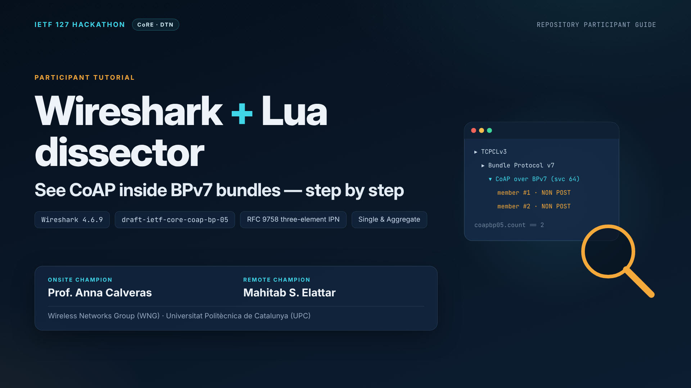

# Wireshark 4.6.9 + Lua dissector — CoAP over BPv7 participant guide

**IETF 127 Hackathon · CoRE · DTN**



This guide shows Hackathon participants how to **see CoAP messages travelling inside Bundle Protocol version 7 (BPv7) bundles**, using Wireshark 4.6.9 and the project's experimental Lua dissector. The testbed is a controlled three-node Rover → Satellite → Earth network running a direct, **no-proxy** CoAP-over-BPv7 research prototype based on `draft-ietf-core-coap-bp-05`, RFC 9171 and RFC 9758.

| | |
|---|---|
| **Onsite Champion** | Prof. Anna Calveras |
| **Remote Champion** | Mahitab S. Elattar |
| **Group** | Wireless Networks Group (WNG), Universitat Politècnica de Catalunya (UPC) |
| **Repository** | https://github.com/ENTEL-WNG/CoAPoverBP-IPN-Draft05-NoProxy |

## Watch the narrated tutorial

| File | What it is |
|---|---|
| [`IETF127_Wireshark_Lua_Tutorial_Narrated.mp4`](IETF127_Wireshark_Lua_Tutorial_Narrated.mp4) | 22-slide tutorial, 1080p, with English voice-over and built-in subtitles |
| [`IETF127_Wireshark_Lua_Tutorial_Narrated.srt`](IETF127_Wireshark_Lua_Tutorial_Narrated.srt) | Subtitles, for players or upload platforms that need a separate file |
| [`TRANSCRIPT.md`](TRANSCRIPT.md) | The full narration, slide by slide, for reading or translating |

The sections below follow the same order as the video.

---

## 1. What Wireshark does — and does not do

| Role | Components |
|---|---|
| **Implementation** — does the work | Modified aiocoap applications on the Rover and Earth → AAP2 → patched µD3TN bundle nodes |
| **Observation** — watches the work | `tcpdump` / `dumpcap` → Wireshark 4.6.9 → Lua dissector |

The Lua file is a **dissector**. It decodes the bundles that are already on the wire; it is **not** a transport implementation, a proxy or a routing process.

**Research question.** Can one BPv7 bundle carry two NON POST requests and still deliver two independently correlated responses? We answer it by inspecting the actual frames, EIDs, bundle lifetime, member Message IDs and Tokens.

## 2. The tested configuration

| Node | Lab IPv4 (`enp0s8`) | Three-component IPN node EID | TCPCLv3 port | Role |
|---|---|---|---|---|
| Rover | `192.168.100.3` | `ipn:974848.1.0` | `4771` | CoAP clients: Safety (`.10`), Science (`.11`) |
| Satellite | `192.168.100.2` | `ipn:974848.2.0` | `4772` | BPv7 relay only — no CoAP proxy |
| Earth | `192.168.100.1` | `ipn:974848.3.0` | `4773` | CoAP server (`.64`) |

Application EIDs: Rover Safety `ipn:974848.1.10`, Rover Science `ipn:974848.1.11`, Earth CoAP `ipn:974848.3.64`.
**Live capture point:** Earth, interface `enp0s8`, Satellite → Earth TCPCLv3 on port `4773`.

> [!IMPORTANT]
> **Match the configuration of *your* run.** The repository's existing README and shell scripts may still describe an *earlier* baseline with allocator `0` and ports `4671` / `4672` / `4673`. The video and the observations below come from a *later verified run* with allocator `974848` and ports `4771` / `4772` / `4773`. Read the `--node-id`, `--cla`, AAP2 socket and routes from your own running installation, and do not mix the two. The video does not demonstrate a clean-room installation from a fresh checkout.

### Reading a three-level IPN address (RFC 9758)

```text
ipn : 974848 . 3 . 64
      │        │   └── service   – which application on the node (64 = Earth CoAP)
      │        └────── node      – which machine (3 = Earth)
      └─────────────── allocator – which organization issued the node numbers
```

In Wireshark 4.6.9, **Scheme Code = 2** identifies the IPN scheme, and **IPN Element Count = 3** confirms that allocator, node and service are encoded as three separate CBOR elements. These are two different fields — check both.

## 3. Get the existing Lua dissector

No new dissector is needed. Clone the repository, or use your existing checkout:

```bash
git clone https://github.com/ENTEL-WNG/CoAPoverBP-IPN-Draft05-NoProxy.git
cd CoAPoverBP-IPN-Draft05-NoProxy
ls -lh wireshark/coapbp05_ipn64_PL65000.lua
```

The plugin registers its experimental payload dissector for destination IPN services **64, 10 and 11** in the `bpv7.payload.ipn_serv` dissector table. It decodes the CoAP/BP 24-bit Message ID, Tokens, URI options, Payload-length and each member's payload.

## 4. Install the plugin

1. In Wireshark 4.6.9 open **Help → About Wireshark → Folders** and find **Personal Lua Plugins**. Use the folder *shown by the Wireshark you are running*; this matters with the Flatpak sandbox.
2. Copy the Lua file there:

   ```bash
   PLUGIN_DIR='/replace/with/the/personal-Lua-plugins-path/shown-by-Wireshark'
   mkdir -p "$PLUGIN_DIR"
   cp wireshark/coapbp05_ipn64_PL65000.lua "$PLUGIN_DIR/"
   ```

3. Restart Wireshark.

> [!NOTE]
> A native Linux installation usually uses `~/.local/lib/wireshark/plugins`. **Do not assume** the Flatpak uses the same host path.

## 5. Check that the dissector loaded

Open a bundle capture or start live traffic, then try these **display filters** (they go in Wireshark's filter bar, not in a shell):

```text
bpv7                        all bundles
coapbp05.count == 1         Single bundles
coapbp05.count == 2         two-member Aggregate bundles
bpv7.eid.ipn_count == 3     three-element IPN EIDs
bpv7.eid.ipn_alloc == 974848
```

Expected packet tree: **DTN Bundle Protocol Version 7 → CoAP over BPv7 → CoAP member #1 / #2**.
If `coapbp05.count` is not recognized, check the plugin path and look for Lua errors at Wireshark startup.

## 6. Capture TCPCLv3 traffic live

| Wireshark installation | How to capture |
|---|---|
| **Native** | Select `enp0s8` in the interface list and start capturing before new TCPCL traffic. Optional capture filter: `tcp port 4773`. |
| **Flatpak 4.6.9** (used in the verified Earth demonstration) | The sandbox cannot capture `enp0s8` directly. Host `tcpdump` streams raw PCAP into a named pipe (FIFO), and Wireshark reads it live. These are genuine live packets. |

```text
Earth enp0s8 ──► host tcpdump ──► named pipe (.fifo) ──► Wireshark 4.6.9 (Flatpak) ──► TCPCLv3 → BPv7 → Lua CoAP
```

From a terminal **on Earth**, at the repository root:

```bash
chmod +x scripts/IETF127_Wireshark_IPN_Live_Capture.sh
./scripts/IETF127_Wireshark_IPN_Live_Capture.sh enp0s8

# capture only the Earth TCPCL port of the current run
CAPTURE_FILTER='tcp port 4773' ./scripts/IETF127_Wireshark_IPN_Live_Capture.sh enp0s8

# show usage
./scripts/IETF127_Wireshark_IPN_Live_Capture.sh --help
```

- The default capture filter is `ip or ip6`, so ordinary ICMP or NTP packets confirm that the pipe works.
- Requirements: Linux `tcpdump`, `flatpak`, `ip`, `mkfifo` and host `sudo` capture rights. The script checks these before it starts.
- **Keep the launcher terminal open** for the whole capture. Closing Wireshark stops `tcpdump` and removes the pipe.
- The helper does **not** restart µD3TN, NodeB, the Rover GUI, the AAP2 agents or the contact manager.
- For full TCPCL stream decoding, start the capture **before the TCPCL handshake** when possible.
- Save the capture with **File → Save As** as `.pcapng` while Wireshark still holds the full packet data.

## 7. Find your TCPCLv3 conversation

```text
tcp.port == 4773     current run
tcp.port == 4673     older repository baseline
bpv7
```

## 8. Troubleshooting

| Symptom | What to check |
|---|---|
| Packets stay as plain **TCP** | **Analyze → Decode As** → TCP port `4773` → TCPCLv3. Capture the connection handshake for reliable reassembly. |
| `coapbp05.count` filter is unknown | The Lua file is not in the *Personal Lua Plugins* folder shown by Wireshark, or it failed to load — check for Lua startup errors. |
| No packets in the Flatpak | Interface name (`ip -br addr`), `sudo` rights, and that the launcher terminal is still open. |
| Nothing on port 4773 | Your lab may use the older baseline (`4673`) — check the running µD3TN `--cla` settings. |
| Frame length looks too small | One Ethernet frame's length is not the BPv7 bundle or application-payload length — read the reassembled values. |
| Bundles expire unexpectedly | Synchronize the VM clocks; stale BPv7 creation timestamps caused lifetime expiry in an earlier attempted run. |

## 9. Packet-level results shown in the video

| Verification | Actual observation |
|---|---|
| Rover Safety Single GET (frame 14) | `ipn:974848.1.10` → `ipn:974848.3.64`, NON GET, one message, **59-byte** BP application payload, Payload-length option absent |
| Safety response (frame 31) | Separate NON `2.05 Content` response, **103-byte** BP application payload, matching Token `684d4727` |
| Rover Science Aggregate (frame 76) | **One** BPv7 bundle carrying **two** NON POST members; **212-byte** payload; **50-byte** Payload-length per POST |
| POST member 1 | MID `2543436`, Token `2f8ecb82` |
| POST member 2 | MID `2543437`, Token `715deaac` |
| IPN scheme | Scheme code **2** (`IPN`), **three-element** scheme-specific array for both source and destination EIDs |
| Destination EID | Allocator `974848`, node `3`, service `64` |
| Aggregate lifetime | **90,000 ms** in the BPv7 primary block, CRC-16 status `Good` |
| Application results | **4/4 Safety GET**, **3/3 Science POST** with matching response Tokens; the two Aggregate POSTs received individual `2.01 Created` responses |

These are **observations of one validated lab run**, not universal protocol values; Message IDs change from run to run. Screenshots show actual Wireshark analysis; commands and diagrams are explanatory graphics.

## 10. Standards notes and limitations

- **Verified:** Single and Aggregate framing, three-element EIDs and token-matched responses in this controlled testbed.
- **Experimental option:** the local fork uses Payload-length option **65000**. It is not a final IANA-assigned Draft-05 option number, and its option-bit properties still need alignment with the draft. Do not claim full Draft-05 conformance.
- **Congestion:** the two-member Aggregate used experimental **NSTART = 2**, two-message buffering and a 10-second aggregation delay. This does not demonstrate general congestion safety.
- **Scope:** the Satellite is only a BP relay; there is no application-level CoAP proxy. The two responses are separate Single bundles, not one response Aggregate. The Lua plugin decodes traffic and does not implement CoAP, routing or a proxy.
- **Security:** the software and traffic come from an isolated, trusted research environment. Do not expose unauthenticated AAP2 management endpoints, and do not upload credentials or private traffic to GitHub.

## 11. Share a reproducible run — checklist

1. **Install the matching Lua plugin** in the Personal Lua Plugins folder that Wireshark shows.
2. **Start the capture before the test** — native `enp0s8` or the Flatpak pipe launcher.
3. **Confirm decoding:** TCPCLv3 → BPv7 → CoAP over BPv7.
4. **Record the IPN fields:** `ipn_count = 3`, allocator, node, service.
5. **Record transaction details:** MIDs, Tokens, payload sizes, lifetime, replies.
6. **Save `.pcapng` + logs** — with no secrets, credentials or sensitive local files.

## 12. Repository layout

Copy the files into the Hackathon repository as follows (nothing is changed automatically):

```text
docs/tutorials/wireshark-lua/
  README.md                                     this guide
  TRANSCRIPT.md                                 narration, slide by slide
  IETF127_Wireshark_Lua_Tutorial_Narrated.mp4   narrated tutorial video
  IETF127_Wireshark_Lua_Tutorial_Narrated.srt   subtitles
  IETF127_Wireshark_Lua_Tutorial_Cover.png      cover image
scripts/
  IETF127_Wireshark_IPN_Live_Capture.sh         Flatpak live-capture helper
```

Add the saved `.pcapng` to an evidence folder after reviewing it for sensitive data. Credit the protocol work to its authors, and keep the demo configuration accurate. The slides and cover contain no calendar dates.

## References

- Internet-Draft `draft-ietf-core-coap-bp-05`: https://datatracker.ietf.org/doc/draft-ietf-core-coap-bp-05/
- RFC 9171, Bundle Protocol Version 7: https://www.rfc-editor.org/rfc/rfc9171.html
- RFC 9758, updates to the `ipn` URI scheme: https://www.rfc-editor.org/rfc/rfc9758.html
- Wireshark BPv7 display-filter fields: https://www.wireshark.org/docs/dfref/b/bpv7.html
- Wireshark capture from pipes: https://wiki.wireshark.org/CaptureSetup/Pipes
- Wireshark personal plugin folders: https://www.wireshark.org/docs/wsug_html_chunked/ChPluginFolders.html
