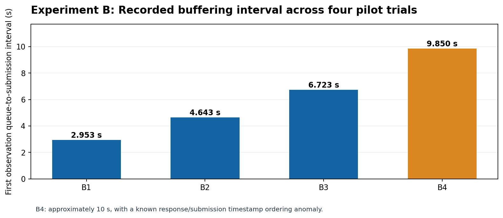
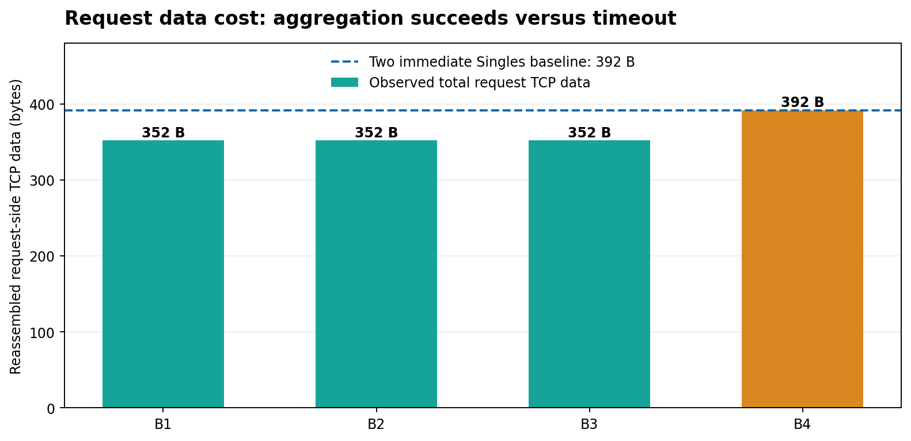
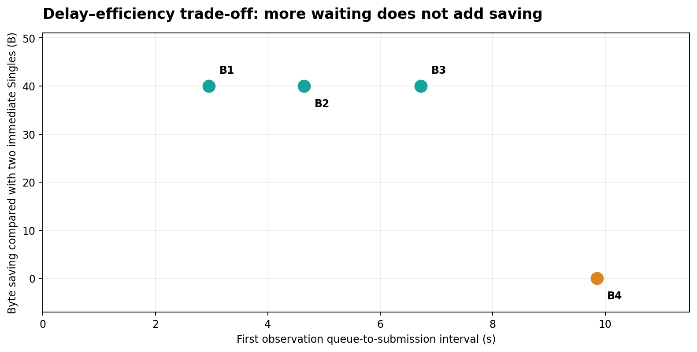

# Experiment B — Aggregation Waiting Time and Timeout

> **Project:** CoAP over BPv7 with three-component IPN addressing (Draft-05, no proxy)  
> **Status:** Initial four-case functional pilot; timing instrumentation needs further validation  
> **Date:** 8 November 2026  
> **Topology:** Rover (`ipn:0.1.11`) → Satellite (`ipn:0.2.0`) → Earth CoAP service (`ipn:0.3.64`)

## Research question

**How much buffering delay is introduced while waiting for a second CoAP observation, and when does this waiting cease to provide byte savings?**

Experiment A established that two fixed 100-byte Science observations sent as separate Singles consume 392 bytes of **reassembled TCP request data**, whereas a two-member Aggregate consumes 352 bytes. Experiment B holds message size constant and varies the arrival gap. All tests used continuously connected Rover–Satellite–Earth links; no outage schedule or link-shaping was introduced for this study.

## Hypothesis

When the second request arrives before the 10-second aggregation timeout, one two-member Aggregate should save 40 bytes at the cost of delaying the first request. When the timer expires before the second request, each observation will be sent as a Single, eliminating that byte saving while introducing buffering delay.

## Configuration

| Parameter | Value |
|---|---|
| Protocols | CoAP NON over BPv7 over TCPCLv3 |
| CoAP application | Science POST `/science/observations` |
| Source application EID | `ipn:0.1.11` (Rover) |
| Destination EID | `ipn:0.3.64` (Earth) |
| Relay node | `ipn:0.2.0` (Satellite) |
| JSON payload per observation | **100 bytes**, fixed benchmark files |
| Rover mode | Aggregate, with runtime NSTART = 2 |
| Maximum aggregation delay | 10 seconds |
| Single BP payload | 147 bytes |
| Two-member Aggregate BP payload | 302 bytes |
| Reference Single request TCP data | 196 bytes each |
| Aggregate request TCP data | 352 bytes |
| Network | Continuous connectivity, no scheduled disruptions |

The recorded `time_epoch` events come from Rover’s local event log. Wireshark was captured at Earth on `enp0s8` with `tcp port 4673` and display filter `bpv7`. Packet timestamps from Earth and application timestamps from Rover are **not combined to estimate end-to-end delay**, because independent VM clocks have not been established as sufficiently aligned for this purpose.

## Results

| Test | Queued-message gap | First queue → submission | Second queue → submission | Request bundles | Request TCP data | Bytes saved | Matched replies |
|---|---:|---:|---:|---:|---:|---:|---:|
| **B1** (Aggregate) | 2.952 s | **2.953 s** | 0.000 s | 1 | 352 B | 40 B | 2/2 |
| **B2** (Aggregate) | 4.643 s | **4.643 s** | 0.000 s | 1 | 352 B | 40 B | 2/2 |
| **B3** (Aggregate) | 6.723 s | **6.723 s** | 0.000 s | 1 | 352 B | 40 B | 2/2 |
| **B4** (Single after timeout) | 15.621 s | **9.850 s** | 10.009 s | 2 | 392 B | 0 B | 2/2 |

**B4 caveat:** The first response is logged **87.180 ms before** its matching `submitted` event. Consequently, B4’s first queue→submission interval (9.850 s) should be interpreted as a **recorded/logged interval**, not a validated precise physical buffering duration. The second Single’s 10.009 s recorded queue→submission interval and the explicit timeout-related GUI messages corroborate approximately 10-second fallback behavior.

### Figures







## Calculations

Define `Q_i` as Rover queue-entry epoch for message *i*, `S_i` as the time of the matching local `submitted` event, and `R_i` as the time of the matching response event. All are seconds in the same Rover event-log clock.

- **Queue-to-submission interval:** `W_i = S_i - Q_i`
- **Inter-arrival gap:** `A = Q_2 - Q_1`
- **Queue-to-response interval:** `C_i = R_i - Q_i` (only interpretable where event ordering is plausible)
- **Request-side saving:** `S_B = B_(two Singles) - B_(observed requests)`

For B3 (two successful Aggregate members):

```text
W_first = 1794129512.7615855 - 1794129506.0386162 = 6.7229693 s
W_second = 1794129512.7615855 - 1794129512.7613018 = 0.0002837 s
Savings = 2 × 196 B - 352 B = 40 B = 10.20%
```

For B4 (two Singles after timeout):

```text
W_first  = 1794129793.6897304 - 1794129783.8392909 = 9.8504395 s
W_second = 1794129809.4696455 - 1794129799.4603777 = 10.0092678 s
Savings = 2 × 196 B - (196 B + 196 B) = 0 B
Anomaly = response_first - submitted_first = -0.0871804 s
```

The GUI `rtt_ms` metric is **not** substituted for these queue-to-submission measurements; it does not consistently equal `R_i - S_i`. We need to inspect the relevant instrumentation points before reporting GUI RTT as post-submission latency.

## Wireshark corroboration

| Trial | Earth request frames | Earth response frames | Observed BP payload(s) | TCP data |
|---|---|---|---|---|
| B1 | 10 (Aggregate) | 13, 33 | 302 B | 352 B |
| B2 | 19 (Aggregate) | 36, 54 | 302 B | 352 B |
| B3 | 16 (Aggregate) | 34, 51 | 302 B | 352 B |
| B4 | 16, 44 (Singles) | 27, 60 | 147 B each | 196 + 196 = 392 B |

Wireshark’s **Reassembled TCP Segments** field—not the packet-list “Length” column—is the basis of the TCP-data comparison. These values include BPv7/TCPCL serialization but **exclude** TCP/IP/Ethernet headers and other traffic. Each response was `2.01 Created` and the application reported matching Tokens.

## Interpretation and boundary of the claim

The three successful Aggregate pilots show that a longer gap increases the first message’s buffering delay but does not change the 40-byte saving for this fixed pair of messages. The timeout pilot demonstrates that the sender can incur almost 10 seconds of recorded buffering delay **with no aggregation saving** if arrivals are too far apart.

**This does not establish an optimal timeout**, end-to-end latency improvement, network-wide congestion reduction, or congestion-control safety for NSTART=2. We have one run per case, manually timed arrivals, and a known event-ordering inconsistency. These pilot findings motivate an automated and repeated study with improved timestamp instrumentation.

## Data quality and limitations

1. The manually clicked intervals were approximately 2.952 s, 4.643 s, 6.723 s and 15.621 s—not precisely the intended intervals. We use logged times, not the intended delay.
2. B4’s first `response` event precedes its `submitted` event by 87.180 ms. The event order and source instrumentation must be investigated.
3. The GUI RTT metric does not consistently match the submitted-to-response event deltas; no unvalidated RTT conversion is used.
4. Screenshots and user-provided log **excerpts** are preserved here, but the full original JSONL files and `.pcapng` captures have not been included. Add them from the VMs to support reproducibility.
5. Four pilot runs do not constitute statistical evidence. Automated scheduling with repeated trials, confidence intervals and an independent queue/submission timing check are required.
6. Draft-05 Section 6 requires congestion-control safety consideration if raising NSTART above its default. Successful delivery in these low-rate pilots does not prove that safety.

## Next controlled experiments

1. Fix or distinguish the `submitted` event instrumentation so logs cannot imply a reply arrived before submission.
2. Generate pairs at precisely scheduled inter-arrival gaps (for example 0.5, 2, 5, 8, 9.5, 10.5, 12 s), with 10+ replicates per setting and recorded monotonic timestamps.
3. Measure first-message queue-to-submission, first- and second-message queue-to-response, Aggregate probability, byte saving and distributions (median, p95).
4. Compare against immediate Single-mode submissions using the same load, and separately assess congestion-control safety under increasing request rates.

## Repository contents

```text
experiment-b-aggregation-waiting-time/
├── README.md
├── Experiment_B_Aggregation_Waiting_Time_Report.docx
├── data/
│   ├── measurements.csv
│   ├── verify_calculations.py
│   └── event_log_excerpts/   # verbatim pasted excerpts; NOT full source logs
├── figures/             # three generated plots
└── evidence/            # original screenshot evidence, B1–B4
```

## Primary sources

- [CoAP over Bundle Protocol, Internet-Draft draft-ietf-core-coap-bp-05](https://datatracker.ietf.org/doc/draft-ietf-core-coap-bp-05/) (implementation target; see aggregation and Section 6)
- [RFC 9171 — Bundle Protocol Version 7](https://www.rfc-editor.org/rfc/rfc9171)
- [RFC 9758 — IPN Naming Scheme](https://www.rfc-editor.org/rfc/rfc9758)
- [RFC 7252 — The Constrained Application Protocol](https://www.rfc-editor.org/rfc/rfc7252)

*Prepared from user-supplied Rover logs and Earth Wireshark screenshots for four functional pilot tests on 8 November 2026.*
