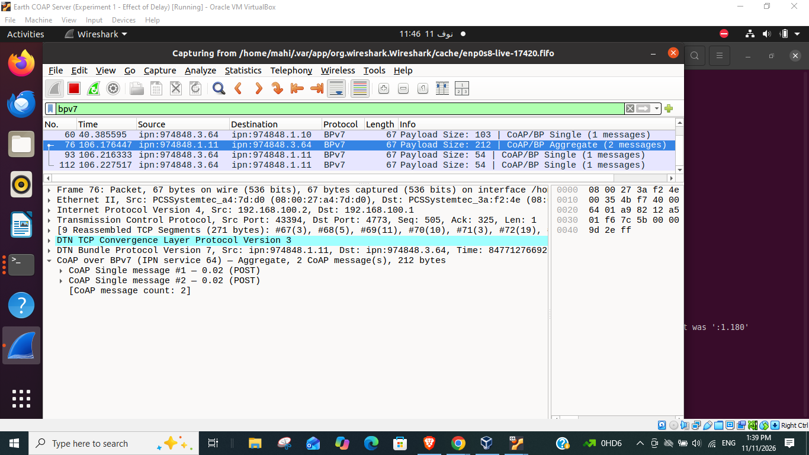
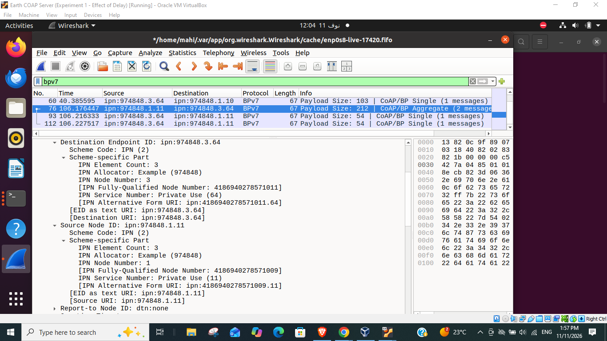

# Experiment A — Payload Size Versus Aggregation Efficiency

**Current demonstration profile:** `ipn:974848.node.service` (RFC 9758 three-element wire encoding); µD3TN / AAP2; TCPCLv3 ports **4771–4773**; direct CoAP over BPv7 (no proxy); Wireshark **4.6.9** and an experimental CoAP/BPv7 Lua dissector.

> **Evidence integrity:** The original five-size efficiency measurements in this package were collected under an **earlier allocator-0 configuration**. Their calculations are preserved but **not re-labelled or recalculated** as allocator-974848 results. The newer screenshots demonstrate a 50-byte two-member Science Aggregate under allocator 974848. A complete new matched benchmark is still required.

[Open the revised report](Experiment_A_Payload_Size_Updated_IPN974848_Report.docx) · [Current evidence log](data/current_allocator974848_observations.csv) · [Historical measurements](data/measurements.csv)

## 1. Updated configuration (current experiment)

| Component | Internal IP | RFC 9758 three-component EID | TCPCLv3 |
|---|---|---|---:|
| Rover node | `192.168.100.3` | `ipn:974848.1.0` | 4771 |
| Satellite relay | `192.168.100.2` | `ipn:974848.2.0` | 4772 |
| Earth node | `192.168.100.1` | `ipn:974848.3.0` | 4773 |
| Rover Safety | Rover application | `ipn:974848.1.10` | AAP2 via Rover node |
| Rover Science | Rover application | `ipn:974848.1.11` | AAP2 via Rover node |
| Earth CoAP server | Earth application | `ipn:974848.3.64` | AAP2 via Earth node |

- **Science URI:** `coap://64.3.974848.ipn.alt/science/observations`
- **Safety URI:** `coap://64.3.974848.ipn.alt/mission/safety-guidance`
- **Protocol scope:** CoAP NON only; three-component `ipn:` EIDs; no CoAP proxy; Satellite forwards BPv7 bundles.
- **Experimental control settings:** Single NSTART=1; tested two-member Aggregate used NSTART=2, buffer limit 2, maximum buffering delay 10 s. The console displayed an initial NSTART ceiling of 1 in this run; **effective congestion-limit enforcement needs a separate configuration/code check**.
- **Bundle lifetimes:** Single 100,000 ms; two-member NON Aggregate 90,000 ms, verified from the current BPv7 primary block.
- **Time synchronization:** Check `date -u` / `chronyc tracking` on all VMs before starting an experiment. A large clock mismatch previously caused Earth to discard incoming bundles as expired; `System time` should be close to zero and `Leap status` Normal.

### IPN scheme code versus element count

In Wireshark, **`Scheme Code: IPN (2)`** means the BPv7 EID is an IPN address, not that it has two components. `IPN Element Count: 3` is the field that confirms the RFC 9758 three-element CBOR representation. The latest capture shows:

- Source `ipn:974848.1.11`: Allocator **974848**, Node **1**, Service **11**, Count **3**.
- Destination `ipn:974848.3.64`: Allocator **974848**, Node **3**, Service **64**, Count **3**.

## 2. Verified new Wireshark 4.6.9 evidence

| Observable event | Verified result | Evidence |
|---|---|---|
| Safety GET Single | Source `.1.10` → Earth `.3.64`; NON GET; BP application payload **59 B**; lifetime **100,000 ms**; matched `2.05 Content` | `evidence/current_allocator974848/Wireshark_Safety_Single_GET_59B.png` |
| Science POST Aggregate | Source `.1.11` → Earth `.3.64`; **two** NON POST members in **one 212 B BPv7 payload**; MIDs `2543436`, `2543437`; Tokens `2f8ecb82`, `715deaac`; Payload-length **50 B per member** | `evidence/current_allocator974848/Wireshark_Science_Aggregate_212B.png` |
| BPv7 primary block | Aggregate lifetime **90,000 ms**; CRC-16 status Good | `evidence/current_allocator974848/Wireshark_Science_Aggregate_90000ms_PrimaryBlock.png` |
| RFC 9758 three-element IPN | Allocator **974848**, EID element count **3** for both source and destination | `evidence/current_allocator974848/Wireshark_RFC9758_IPN3_Allocator974848.png` |
| Application replies | Two independently matched Earth `2.01 Created` responses; screenshots show response packets; Rover logs show matching tokens | `evidence/current_allocator974848/Wireshark_Science_Response_2_01.png` and `Rover_GUI_Interaction_Summary.png` |

**Note:** The new run also logged a Single Science POST with **102 B** BP application payload and a `2.01 Created` response, but the supplied new Wireshark screenshots do not identify its TCP reassembled size. Therefore, this package makes **no updated serialized-byte saving calculation** from the newer results.





## 3. How to reproduce Wireshark analysis on Earth

For the **existing tested lab**, do not restart µD3TN daemons, AAP2, contact schedules, or NodeB just to launch Wireshark. Check that Rover, Satellite, Earth and their active contacts are ready; test `ip -br addr` and time sync.

The native **Wireshark 4.4.9** can capture from `enp0s8` but lacks the new IPN allocator/count dissection fields. The **Wireshark 4.6.9 Flatpak** provides the RFC 9758 fields but does not capture Linux network interfaces directly in its sandbox. This package includes the **read-only FIFO/tcpdump helper** used to stream Earth `enp0s8` traffic to Wireshark 4.6.9:

```bash
# On Earth, from the experiment folder; use broad filtering while diagnosing:
bash scripts/wireshark_ipn974848_live.sh enp0s8

# Optional: restrict to the CURRENT Earth TCPCLv3 port:
CAPTURE_FILTER='tcp port 4773' bash scripts/wireshark_ipn974848_live.sh enp0s8
```

Keep the launcher terminal open. Start capture **before** generating a new Rover request, ideally from the TCPCL handshake where possible. In Wireshark 4.6.9:

```text
bpv7                          # decoded BPv7 bundles
tcp.port == 4773              # Earth TCPCLv3 transport
bpv7.eid.ipn_count == 3       # three-element IPN EID decoded
bpv7.eid.ipn_alloc == 974848 # expected allocator
coapbp05.count == 2           # two-member Aggregate, requires Lua dissector
```

For a custom port, choose **Analyze → Decode As → TCP port 4773 → TCPCLv3** if the dissector is not automatically invoked. Expand `DTN Bundle Protocol Version 7 → Primary Block → Destination Endpoint ID / Source Node ID → Scheme-specific Part` to inspect **element count, allocator, node, service**. Expand `CoAP over BPv7` for its Aggregate members.

### Experimental Lua CoAP/BPv7 payload decoder

The repository's existing `wireshark/coapbp05_ipn64_PL65000.lua` registers the CoAP payload decoder for IPN services 64, 10 and 11 and displays the experimental 24-bit MID, CoAP options and Aggregate message count. It does **not** provide the RFC 9758 EID fields; Wireshark 4.6.9 does. To install in the Flatpak instance, first locate its Lua personal plugin folder using **Help → About Wireshark → Folders** and put the Lua file in that folder. Restart the Flatpak Wireshark application. Do not assume the native `/usr/bin/wireshark` plugins folder is the same.

The local `Payload-length` option is **65000**, an experimental placeholder rather than the final IANA allocation; its Critical/Unsafe bit properties do not match Draft‑05's stated requirement. Full Draft‑05 interoperability and NSTART=2 congestion safety remain open test topics.

## 4. Historical allocator-0 payload-size experiment (archived, NOT the current run)

The `data/measurements.csv`, `figures/historical_allocator0/`, and `evidence/historical_allocator0/` files contain original observations using Rover `ipn:0.1.11` (sometimes displayed as `ipn:1.11`), Earth `ipn:0.3.64`, and TCPCLv3 Earth port **4673**. They have **not** been regenerated under allocator 974848.

| JSON bytes per POST | Old two-Single TCP data | Old Aggregate TCP data | Old reported saving | Status |
|---:|---:|---:|---:|---|
| 50 | 292 B | 251 B | 14.04% | historical only |
| 100 | 392 B | 352 B | 10.20% | historical only |
| 227 | 648 B | 606 B | 6.48% | earlier, non-identical workload |
| 500 | 1194 B | 1154 B | 3.35% | historical only |
| 1000 | 2194 B | 2154 B | 1.82% | successful retry after an unexplained first attempt |

The old test suggested that *request-side reconstructed TCP data* was smaller when two requests shared a BPv7 envelope, but these numbers do **not** represent allocator-974848 measurements, total on-wire Ethernet bytes, throughput, or a general congestion-control safety result. They are retained for scientific provenance, not substituted into the updated test.

Recheck only the arithmetic of those old values:

```bash
python3 data/verify_calculations.py
```

Original report and README retained under `archive/allocator0_original/`.

## 5. How to rerun the payload-size comparison with allocator 974848

1. Preserve the current working binaries, GUI, contact schedule and Python environments; never replace or restart GUI-managed nodes merely to conduct the test.
2. For each exact fixed JSON payload size (**50, 100, 227, 500, 1,000 B**), send **two sequential Singles** (`NSTART=1`) using precisely the same two payloads that will be used for the Aggregate.
3. Queue those same two NON POSTs inside the 10-second aggregation window (`NSTART=2` only in a controlled, explicitly configured test). Verify **two distinct MIDs and Tokens** in one BPv7 payload.
4. Capture request bundles on Earth under TCPCLv3 port 4773; record **both Singles' actual reconstructed TCPCL message sizes** and the Aggregate's actual reconstructed TCPCL message size, plus BP application payload bytes.
5. For each pair compute `saving = (Single1_TCP + Single2_TCP - Aggregate_TCP)` and `saving_% = 100 * saving / (Single1_TCP + Single2_TCP)`; retain logs for two matching `2.01 Created` responses.
6. Save one `.pcapng`, unmodified screenshots, the exact JSON inputs, stdout/JSONL logs, timestamps, contact configuration and code revision for each mode and size. Record unsuccessful attempts rather than silently removing them.

The **updated 212-byte Aggregate** is evidence that the new allocator profile works, but it is not by itself an efficiency benchmark. A full rerun is needed before updating the old figures and percentages.

## 6. References and disclosure

- [CoAP over BPv7 Draft-05](https://datatracker.ietf.org/doc/draft-ietf-core-coap-bp-05/)
- [RFC 9171 — Bundle Protocol Version 7](https://www.rfc-editor.org/rfc/rfc9171)
- [RFC 9758 — IPN URI Scheme Update](https://www.rfc-editor.org/rfc/rfc9758)
- Experimental research prototype; no proxy and no production conformance claim.
- AI assistance was used for document/code editing and review; all wire-format claims above refer to the supplied Wireshark screenshots and run logs.
