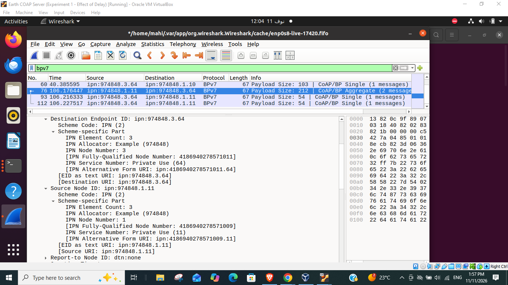
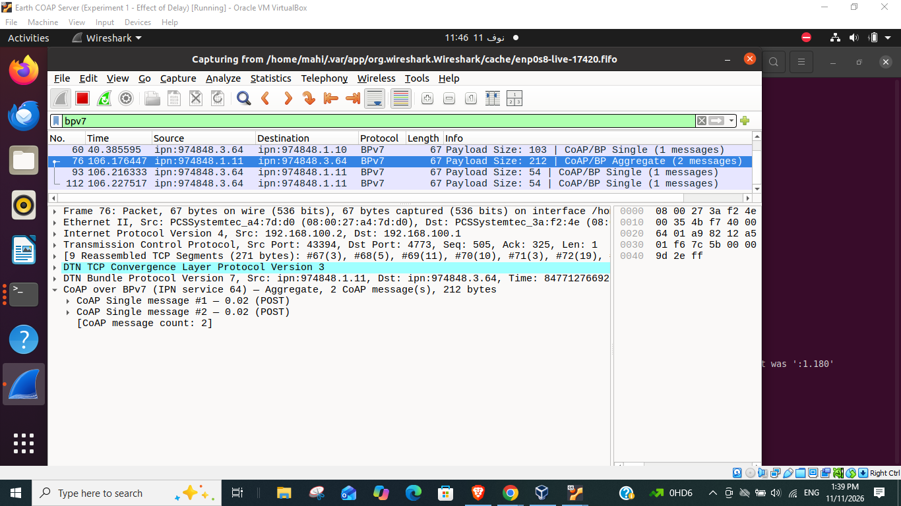
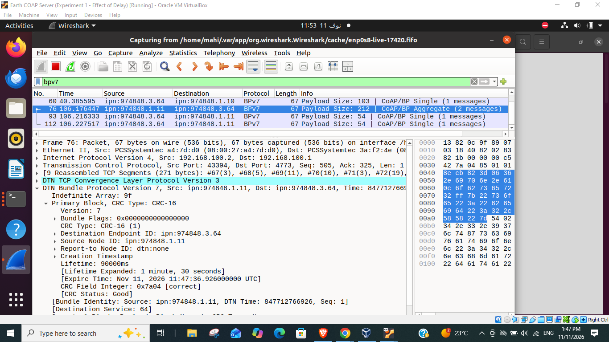
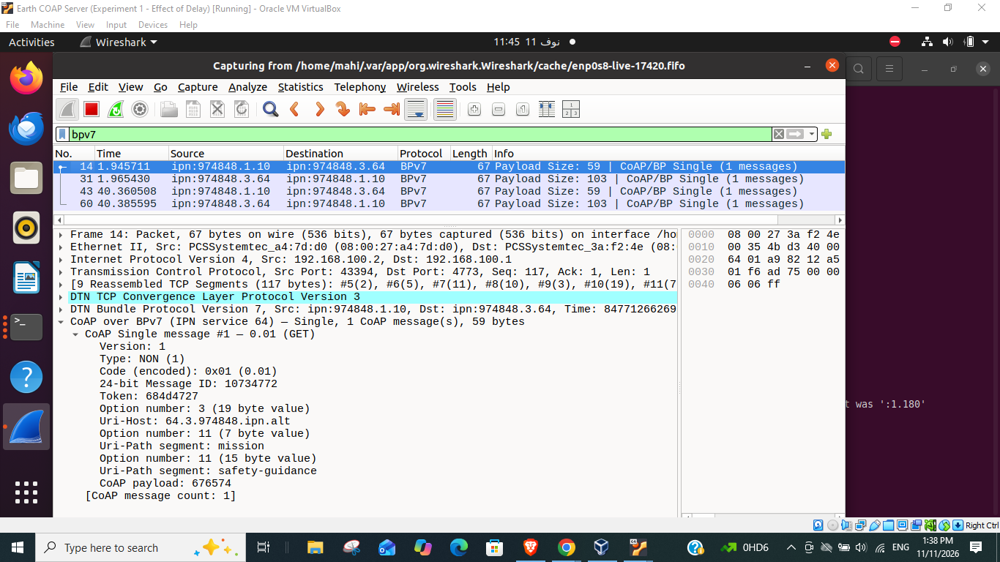

# Experiment C — Payload Size Versus Aggregation Efficiency

**Project:** CoAP over BPv7 with RFC 9758 three-component IPN addressing  
**Current lab allocator:** `974848`  
**Target:** IETF 127 Hackathon / UPC Wireless Networks Group (WNG)  
**Scope:** Updated functional demonstration **plus a separately preserved historical payload-size sweep**.

> **Do not combine the two datasets.** This package updates the configuration and screen evidence to the later experiment using `ipn:974848.*.*` and TCPCLv3 ports `4771–4773`. The original five-size byte-efficiency observations came from an **older allocator-0 configuration**. The older tables and charts remain available for provenance, but their measured percentages have **not been remeasured** under allocator 974848.

## 1. Latest verified configuration (allocator 974848)

| VM | IP (interface `enp0s8`) | Node EID | TCPCLv3 port | Application EID |
|---|---|---|---:|---|
| Rover | `192.168.100.3` | `ipn:974848.1.0` | `4771` | Safety `ipn:974848.1.10`; Science `ipn:974848.1.11` |
| Satellite | `192.168.100.2` | `ipn:974848.2.0` | `4772` | BP relay only (no CoAP proxy) |
| Earth | `192.168.100.1` | `ipn:974848.3.0` | `4773` | CoAP server `ipn:974848.3.64` |

The Science URI is `coap://64.3.974848.ipn.alt/science/observations` and the Safety URI is `coap://64.3.974848.ipn.alt/mission/safety-guidance`. CoAP messages run **directly over BPv7 via µD3TN/AAP2**, with TCPCLv3 links and no UDP CoAP proxy. This lab uses the locally modified aiocoap and patched µD3TN versions; do not substitute a stock binary without testing three-component IPN encoding.

## 2. Updated functional results and packet evidence

| Verification | Evidence from current run | Result |
|---|---|---|
| Single Safety GET | One NON GET, BP application payload **59 B**; Payload-length **absent**; requested lifetime **100,000 ms** | **4/4** token-matched `2.05 Content` responses |
| Single Science POST | One NON POST, BP application payload **102 B** | **1/1** token-matched `2.01 Created` response |
| Science Aggregate | **One BPv7 bundle**, **212 B** application payload; two NON POST members, each with a **50 B Payload-length** value | **2/2** token-matched `2.01 Created` responses |
| BPv7 lifetime | Wireshark frame **76** Primary Block: **90,000 ms**, CRC-16 good | Verified on the wire |
| RFC 9758 IPN | Wireshark frame **76**: Scheme Code IPN `(2)`, **IPN Element Count = 3** for both source and destination | Allocator **974848**, node **1→3**, service **11→64** |

The current Aggregate's first two request members have MIDs `2543436` and `2543437`, and Tokens `2f8ecb82` and `715deaac`. The Earth application parsed both and sent two *separate* Single responses. Request and response evidence is documented in the screenshots and application logs from the current test; this is **not** a claim of generalized delivery reliability or interoperability.

### Key current Wireshark screenshots

**Three-element IPN source/destination decoding (RFC 9758):**



**Two POSTs in one BPv7 Aggregate (212 B):**



**Primary Block lifetime = 90,000 ms:**



**Single GET request:**



Additional unmodified screenshots and readable crops are in [`evidence/current_ipn974848/`](evidence/current_ipn974848/).

## 3. Understanding the Wireshark decoding

Wireshark **4.6.9 natively decodes** RFC 9758 three-element IPN addresses. It shows:

```text
Destination Endpoint ID: ipn:974848.3.64
  Scheme Code: IPN (2)
  Scheme-specific Part:
    IPN Element Count: 3
    IPN Allocator: 974848
    IPN Node Number: 3
    IPN Service Number: 64

Source Node ID: ipn:974848.1.11
  Scheme Code: IPN (2)
  Scheme-specific Part:
    IPN Element Count: 3
    IPN Allocator: 974848
    IPN Node Number: 1
    IPN Service Number: 11
```

**Scheme Code `2`** identifies the IPN scheme inside a BPv7 endpoint identifier; it **does not mean two IPN components**. Element Count `3` is the evidence of a three-element IPN scheme-specific CBOR representation.

Our experimental **Lua dissector** `wireshark/coapbp05_ipn64_PL65000.lua` is a *separate* layer, providing CoAP-over-BPv7 inspection of Single/Aggregate members, MIDs, Tokens, options and Payload-length. It must be installed from the repository's root `wireshark/` folder. Option **65000** is a prototype value and not the final draft option allocation.

### Wireshark 4.6.9 filters

```text
bpv7
bpv7.eid.ipn_count == 3
bpv7.eid.ipn_alloc == 974848
coapbp05.count == 2
```

On the **Earth VM**, traffic arrives from the Satellite on TCPCLv3 **port 4773**. If TCPCLv3 is not automatically identified, use **Analyze → Decode As** and select TCPCL for TCP port `4773`. For Flatpak Wireshark, live host capture of `enp0s8` requires the host `tcpdump` → FIFO workaround; consult the root [`wireshark/` folder](../../../wireshark/) and capture helper if present. Native Wireshark normally lists host adapters directly.

**Before recording a run:** verify all three VMs are clock-synchronized (e.g., `chronyc tracking`) and that no stale contacts remain. The lab previously discarded bundles as expired when its VM clocks differed by approximately two days. Do not restart GUI-managed µD3TN nodes to fix capture issues.

## 4. Historical payload-size comparison — allocator 0 only

The original Experiment C measured two sequential Singles versus one Aggregate across a range of JSON POST payload sizes under the earlier configuration; request-direction reconstructed TCP bytes were used, not Ethernet wire bytes:

| JSON payload per POST | Two Singles TCP bytes | Aggregate TCP bytes | Saved bytes | Relative saving |
|---:|---:|---:|---:|---:|
| 50 B | 292 B | 251 B | 41 B | 14.04% |
| 100 B | 392 B | 352 B | 40 B | 10.20% |
| 227 B¹ | 648 B | 606 B | 42 B | 6.48% |
| 500 B | 1,194 B | 1,154 B | 40 B | 3.35% |
| 1,000 B | 2,194 B | 2,154 B | 40 B | 1.82% |

¹ The 227 B observation comes from an earlier live Science workload, not a fixed-file control. The complete original methodology, anomalies, evidence and limitations remain in [`archive/README_Legacy_Allocator0.md`](archive/README_Legacy_Allocator0.md) and [`archive/Experiment_C_Original_Legacy_Allocator0_Report.docx`](archive/Experiment_C_Original_Legacy_Allocator0_Report.docx). The original CSV, verifier and figures are unchanged, as are the historical screenshots in [`evidence/legacy_allocator0/`](evidence/legacy_allocator0/).

**Do not infer a new 14.04% saving from the allocator-974848 run.** In the new trace, a 50-byte POST appeared inside a **102-byte Single BP payload**, and two such POSTs formed a **212-byte Aggregate BP payload**, compared with historical **97 B Single / 202 B Aggregate**. The new protocol-overhead values are different, and no equivalent complete TCP-serialization comparison has yet been measured.

To verify the original CSV calculations:

```bash
python3 data/verify_calculations.py
```

## 5. Reproducibility and outstanding questions

- Re-run the complete five-size study with fixed JSON files **using allocator `974848`**, the same modified µD3TN/aiocoap build, and ports `4771–4773`.
- Measure **both modes** on one consistent capture platform: two sequential Singles (`NSTART=1`) and a two-member Aggregate (`NSTART=2`) using the same POST values. Keep the 10 s aggregation deadline explicit. Report serialized BP/TCP bytes and, separately, full on-wire traffic if required.
- Use additional repetitions, note failures and contact intervals, and capture queue-to-send delay separately from response RTT. Do not claim NSTART=2 congestion safety from this functional trace; draft-05 defaults to NSTART=1 and requires safe deployment-specific congestion control for increases.
- Check the experimental Payload-length option number `65000`. Under RFC 7252, that number does not provide the draft's expected Critical/Unsafe bits; its final allocation remains to be coordinated with the standard.
- Archive original `.pcapng`, GUI event JSONL, and Rover/Earth terminal logs in addition to screenshots for future independent confirmation. These original capture files are **not included in this ZIP**.

## Package contents

```text
README.md                                   updated, current IPN 974848 and new evidence
Experiment_C_Payload_Size_Aggregation_Efficiency_Report.docx  revised report
data/measurements.csv                       original allocator-0 measurements, unchanged
data/verify_calculations.py                 historical arithmetic verifier, unchanged
data/current_allocator974848_validation.csv  latest verified function-level results
data/PROVENANCE.md                          explicit data distinction
evidence/current_ipn974848/                current, unmodified Wireshark screenshots
evidence/legacy_allocator0/                historical screenshots, preserved
figures/                                    historical size-sweep charts, preserved
archive/                                    original README and DOCX report
```

## References and acknowledgements

- [draft-ietf-core-coap-bp-05](https://datatracker.ietf.org/doc/draft-ietf-core-coap-bp/05/), particularly Single/Aggregate, Payload-length and NSTART considerations.
- [RFC 9758](https://www.rfc-editor.org/rfc/rfc9758), three-element IPN endpoint identifiers.
- [RFC 9171](https://www.rfc-editor.org/rfc/rfc9171), BPv7.
- [Wireshark 4.6 display filters](https://www.wireshark.org/docs/dfref/b/bpv7.html).

**Project champions:** Prof. Anna Calveras (Onsite) and Mahitab S. Elattar (Remote). Technical feedback was provided by Prof. Carles Gómez. The experiment-specific dissector and documentation were developed with AI assistance for drafting, editing and debugging and reviewed against the supplied packet evidence. No results are represented as independently reproduced unless supporting evidence exists.
